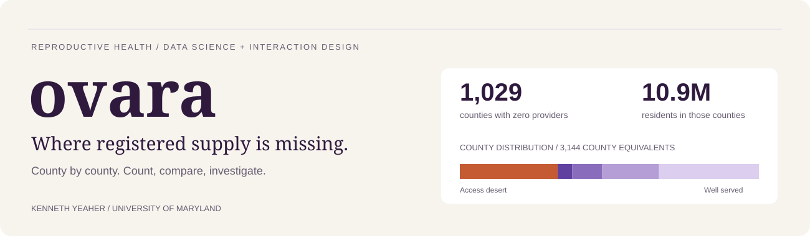
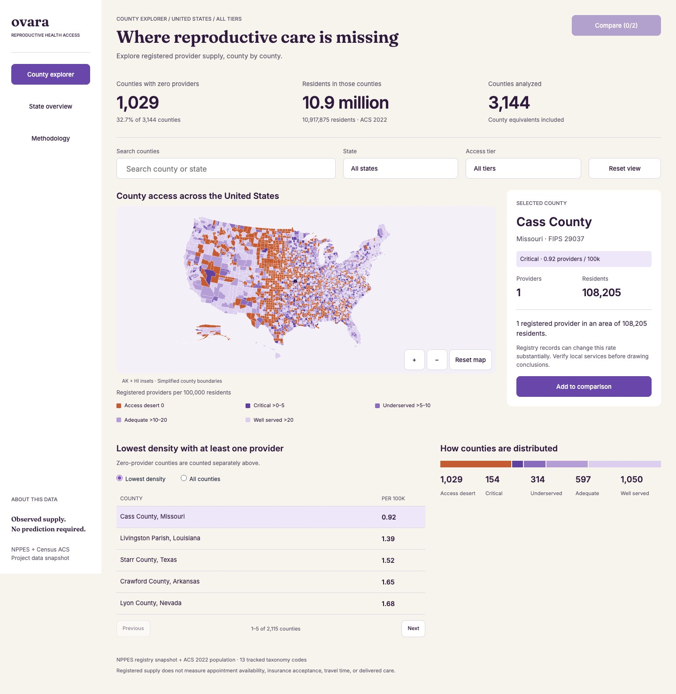
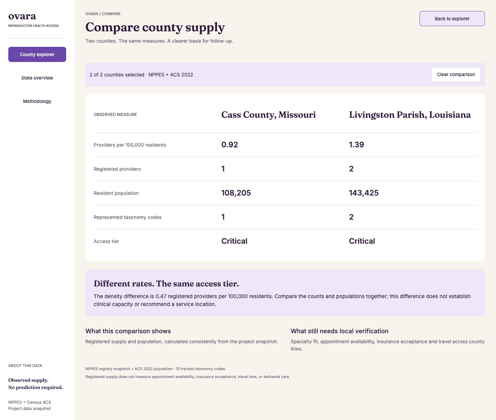
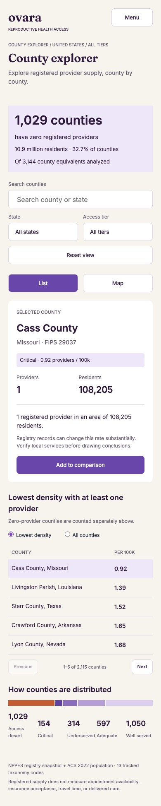
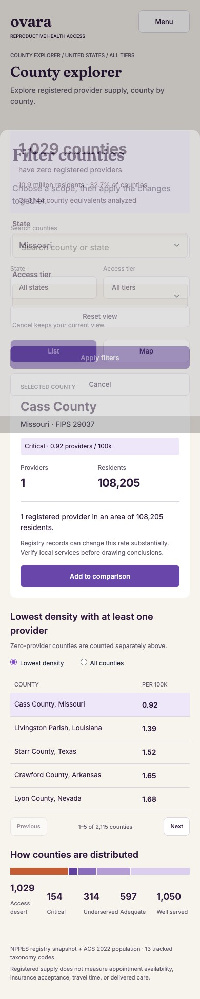

  

  <strong>A reproductive health provider registry, joined to population and made readable.</strong> 
  Data engineering, geographic analysis and an interactive county dashboard. 
  University of Maryland, College of Information · INST737: Data Science Techniques

  
  
  
  
  

  <a href="#the-dashboard"><strong>The dashboard</strong></a> &nbsp; · &nbsp;
  <a href="#the-finding">The finding</a> &nbsp; · &nbsp;
  <a href="#run-locally">Run locally</a> &nbsp; · &nbsp;
  <a href="#verification">Verification</a> &nbsp; · &nbsp;
  <a href="METHODOLOGY.md">Methodology</a> &nbsp; · &nbsp;
  <a href="https://kennethyeaher.github.io/work/ovara/">Portfolio case study</a>

## The dashboard

The county explorer opens on the national finding and keeps the selected county beside the map. Search accepts county names, state names or abbreviations, and five-digit county FIPS codes. State and tier filters apply together. A comparison tray keeps up to two counties visible while the reader looks for another.

The interface uses the **Iris atlas** direction: cream surfaces, an ordered iris ramp for density tiers, and burnt coral for zero registered supply. County geometry comes from the supplied boundaries, including Alaska and Hawaii insets and Connecticut's nine planning regions. The county map makes no tile service or API key request.

<table>
  <tr>
    <td width="66%" valign="top">
      <strong>Compare the rate with its denominator</strong>  
      
       Both counties are Critical. A density difference alone does not establish clinical capacity.
    </td>
    <td width="34%" valign="top">
      <strong>A smaller screen changes the hierarchy</strong>  
      
       Exact values remain available without navigating a tiny national map.
    </td>
  </tr>
</table>

<strong>See the mobile filter sheet</strong>

 

### A short walkthrough

1. Start with **Cass County, Missouri**: one registered provider, 108,205 residents and a density of 0.92 per 100,000.
2. Choose **Add to comparison**. Search for **Livingston Parish** or **22063**, select it, and add it too.
3. Open **Compare (2/2)**. Livingston Parish has two providers and 143,425 residents. Its rate is 1.39 per 100,000.
4. Return to the explorer, open **State**, choose **Missouri**, and apply. The map, list and totals change to 115 county equivalents, 48 access deserts and 614,052 residents in those counties.
5. **Reset view** restores the national scope and clears comparison. **Clear search** only clears the query and keeps saved counties.

| Interaction | Behavior | Where to inspect |
|---|---|---|
| County search | Literal names and FIPS, pagination and keyboard selection | [Scope and search](vis/atlas_model.py), [county controls](vis/atlas_view.py) |
| Draft filters | Apply commits state and tier together; Cancel keeps the current scope | [Callbacks](vis/atlas_callbacks.py) |
| Comparison | Two distinct records, consistent metric order and explicit denominators | [Comparison rules](vis/atlas_model.py), [comparison view](vis/atlas_view.py) |
| Map exploration | Local geographic paths, selection, zoom controls and mouse panning | [Geometry](vis/atlas_map.py), [map interaction](vis/assets/atlas.js) |
| Missing data | Unavailable labels and Retry; missing files never become zero supply | [Application factory](vis/dashboard.py) |
| Responsive layout | List first on mobile, optional map, filter sheet and stacked comparison | [Iris atlas styles](vis/assets/atlas.css) |
| State overview | Observed density and rank; regression is a labeled negative result | [State charts](vis/state_charts.py) |

## The finding

| Observed measure | Result | Interpretation |
|---|---:|---|
| County equivalents analyzed | **3,144** | Includes Connecticut planning regions |
| Counties with zero registered providers | **1,029** | **32.7%** of counties |
| Residents in those counties | **10,917,875** | About **3.3%** of the county dataset population |
| States with at least one such county | **43** | The finding crosses state boundaries |
| State regression cross validated R² | **+0.1244** | Reported as a negative result |

These are figures from the project snapshot, not a current estimate of delivered care. The county finding is a direct count of NPPES registrations in the tracked reproductive health taxonomies against ACS 2022 population. No regression produces the zero-provider count.

A provider may work elsewhere, may no longer be practicing, or may not offer the service a reader needs. The data does not show appointment capacity, insurance acceptance, travel time or whether a clinic accepts new patients. County tiers use project thresholds rather than a clinical standard:

| Access tier | Registered providers per 100,000 |
|---|---:|
| Access desert | 0 |
| Critical | Greater than 0, up to 5 |
| Underserved | Greater than 5, up to 10 |
| Adequate | Greater than 10, up to 20 |
| Well served | Greater than 20 |

## Why I built it

Ovara started from a simple observation: fertility and reproductive healthcare access in the United States is not evenly distributed. I first noticed this while working as a Healthcare Data Analyst for a management consulting company that operated multiple Minimally Invasive Gynecologic Surgery focused Ambulatory Surgery Centers across major East Coast metro areas. The centers were consistently full, patients often traveled long distances for care, and specialty referrals were a normal part of operations. That made me question whether this was just a local business issue or part of a larger access problem.

The challenge is that much of the data needed to study this problem already exists, but it sits inside fragmented federal registries that are difficult to work with. This project builds a data science pipeline that turns raw provider registry data into measurable access intelligence.

The pipeline filters the NPPES registry to reproductive health specialties, assigns practice ZIP codes to counties, joins population, and writes county density features and state diagnostics. Each analytical output has a data dictionary, and the run manifest records source vintages.

## Design decisions

The interface follows the selected [Iris atlas design](https://www.figma.com/design/xnp7LgLytcxYCrp5M354g0?node-id=27-2) and its [interaction flow](https://www.figma.com/design/xnp7LgLytcxYCrp5M354g0?node-id=33-8150). The reading reference is *Designing Interfaces: Patterns for Effective Interaction Design*, third edition, by Jenifer Tidwell, Charles Brewer and Aynne Valencia.

| Reading reference | Decision in Ovara | Reason |
|---|---|---|
| Linked views and Data Brushing, chapter 9, supplied PDF p. 695 | Selection updates the map outline, list and persistent detail | The same record stays recognizable across views |
| Explicit selection as an alternative to hover, chapter 9, supplied PDF p. 705 | County details survive pointer movement; the list supports native button activation | Exact values remain available on touch and keyboard paths |
| Progressive disclosure, supplied PDF p. 238 | Comparison appears after a county is saved; methodology has its own view | The first screen concentrates on exploration |
| Grouping the common workflow, supplied PDF p. 238 | Search, geographic scope and county detail stay together | Reading a county does not require unrelated pages |

PDF positions differ from printed page numbers. These principles informed the design; they are not evidence of improved usability. A study with the intended audience is still needed.

The implementation uses real county geometry and records. Five rows appear in the initial ranked list, with pagination and an all-counties view. Zoom and mouse panning extend the map concept. Browser state stays in memory for the current tab; there is no account, cross-session shortlist or patient data.

## Corrections that changed the project

Three problems in the original analysis produced plausible output. The corrections changed what the dashboard claims.

| Problem | Correction | Guard |
|---|---|---|
| Connecticut ZIP and county codes used different Census vintages | Route ZIPs to nine planning regions; restore 1,275 matched providers | Fail on geographic vintage mismatch |
| Metro population was repeated on every county row | Use ACS county population summed to the state | Check population plausibility |
| A growth feature contained part of the prediction target | Remove the leaking level feature and retire residual based risk tiers | Reject provider-count-derived model features |

The state regression is retained as a negative result. State density is a continuous observed ranking. HRSA comparisons do not establish external validity for the state model or turn county tiers into clinical shortage designations.

<strong>Audit details and corrected figures</strong>

**A feature contained the answer, and the model's score was leakage.** The winning feature set used `growth_per_100k`, which is `recent_provider_growth` divided by `state_population`. The target is `provider_count` divided by `state_population`. Recently enumerated providers are a strict subset of the provider count, in all 51 states, averaging 5.8% nationally and ranging 3.0% to 12.9% by state. The feature was a component of the target over the same denominator.

Replacing the level with a composition measure, `pct_recent_entrants`, the share of a state's workforce that is new, which is not a component of density:

| Feature set | CV R2 |
|---|---:|
| `taxonomy_diversity` + `growth_per_100k`, leaking | +0.3253 |
| `taxonomy_diversity` + `pct_recent_entrants`, leak free | +0.0352 |
| `taxonomy_diversity` alone, selected | +0.1244 |

`pct_recent_entrants` correlates with density at r = -0.0891, p = 0.534. The growth signal was entirely a level effect. **The honest ceiling for this model is about R2 0.12**, and even that is partly mechanical, since a ZIP with more providers has more chances to contain more taxonomies.

A test in `tests/test_access_model_dataset.py` now fails if any feature derived from `provider_count` reappears in `FEATURE_COLUMNS`, and `feature_selection.json` carries a `leakage_check` block recording the subset relationship and the cost of removing it.

**Nothing at state level validates externally.** Against HRSA burden per 100,000 residents, observed density correlates at +0.002, -0.015, -0.109 and -0.240 for shortage population, FTE shortage, designated area count and average HPSA score. Density should correlate negatively with shortage burden. It does not, at any useful strength. The county grain does not rescue it either, for reasons set out in the HRSA section.

Together these two findings changed what this project claims. **The county analysis is the headline finding.** The state regression is reported as a negative result, and the residual based state risk tiers have been retired.

**The state provider density denominator was wrong, and every state level number moved.** `build_population_proxy` summed the CBSA reference table by state. That table has one row per county with the whole metro's population on each row, so the 29 county Atlanta MSA added its 6,411,149 residents 29 times. Georgia's denominator came to 198,940,717 against a true 10,722,325, New Jersey to 266,785,188 against 9,249,063, and Wyoming was under counted at 182,193 against 577,929. Because CBSAs cross state lines, the Washington MSA's population was credited whole to DC, whose real population is 670,587. The 51 state populations summed to 2,187,759,309, about 6.6 times the country.

The inflation ran 0.32x to 28.8x, so it scrambled the state ranking rather than scaling it. The denominator is now ACS county population summed to the state, the same table the county layer uses, and `check_population_plausible` raises if any state falls outside 400,000 to 45,000,000.

| Figure | Published before | Corrected |
|---|---:|---:|
| National density per 100k | 4.55 | 30.06 |
| Georgia denominator | 198,940,717 | 10,722,325 |
| New Jersey denominator | 266,785,188 | 9,249,063 |
| DC denominator | 6,436,489 | 670,587 |
| Wyoming denominator | 182,193 | 577,929 |
| 51 state total | 2,187,759,309 | 331,097,593 |
| Thinnest states | NJ, VA, GA, IN | AR, AL, ND, MS, NV, IA |

The corrected ordering matches published maternity care desert research. The shipped ordering contradicted it. The regression, the residuals, the clustering, both state maps and the HRSA validation all changed as a result. The county layer was never affected, because county density always divided by ACS county population.

**Connecticut was reported as a statewide access desert, and that was wrong.** The county layer assigned zero providers to all of Connecticut because two Census vintages disagreed. The ZIP to county crosswalk came from the 2020 ZCTA relationship file, which still emits Connecticut's eight legacy county codes 09001 through 09015. County population came from the 2022 ACS, the first vintage in which the nine planning regions are the county equivalent, so it holds 09110 through 09190. The two sets share no codes, the population join dropped every matched Connecticut provider, and the nine planning regions were published as access deserts with zero providers each. Nothing warned.

Connecticut ZIPs are now routed to planning regions through a vendored CTData Collaborative crosswalk, and `analysis/build_county_dataset.py` raises rather than writing zeros if a state's crosswalk geography and population geography ever diverge again.

| Figure | Published before | Corrected |
|---|---:|---:|
| CT providers in the county layer | 0 | 1,275 |
| CT planning regions with providers | 0 of 9 | 9 of 9 |
| National access desert counties | 1,038 | 1,029 |
| Residents in access deserts | 14,529,192 | 10,917,875 |

None of the nine planning regions is an access desert. Six are Well Served and three are Adequate.

Two caveats remain. The ZIP to planning region assignment is approximate at boundaries: CTData built it as a centroid nearest neighbour spatial join against 2022 Census boundaries, so a ZIP that straddles two regions is assigned whole to the region containing its centroid. And 89 Connecticut providers still fail the ZIP lookup outright, the same way providers in every other state do when their practice ZIP has no ZCTA match.

## Run locally

Use Python 3.9 or newer. From the repository root:

~~~bash
python3 -m venv .venv
source .venv/bin/activate
python -m pip install -e .
python -m vis.dashboard
~~~

Open **http://127.0.0.1:8050**. To choose another port:

~~~bash
DASH_PORT=8061 python -m vis.dashboard
~~~

Launching the dashboard reads existing outputs and does not rewrite analytical files. It needs these supplied files:

- <code>data/model_outputs/state_density_ranking.csv</code>
- <code>data/model_outputs/county_risk_classified.csv</code>
- <code>data/reference_tables/counties_geojson.json</code>

If county data cannot load, the county view shows an unavailable state with Retry. State diagnostics remain available. The county map uses local boundaries; fonts and Bootstrap styling currently load from public CDNs, and the state map may request Plotly geographic reference data.

<strong>Rebuild the analytical outputs</strong>

The full raw NPPES release is not included because it is roughly 11 GB. Download it from [CMS NPPES](https://download.cms.gov/nppes/NPI_Files.html), place it in the expected extraction folder, and follow [the pipeline reference](docs/PIPELINE.md).

~~~bash
python etl/preprocess_nppes.py
python main.py
~~~

The full pipeline rebuilds outputs and static exports. The interactive visualization workflow also writes exports before launching. Use <code>python -m vis.dashboard</code> to inspect the existing snapshot without rebuilding it.

## Verification

Verified locally on **October 17, 2026**: **63 tests passed**, including **5 isolated Chrome browser tests**.

~~~bash
python -m pip install -e ".[test]"
BROWSER_CHANNEL=chrome python -m pytest -q
~~~

Use an installed Chrome browser with <code>BROWSER_CHANNEL=chrome</code>. For Playwright's Chromium, install its browser with <code>python -m playwright install chromium</code> and omit that environment variable.

| Coverage | Evidence |
|---|---|
| Analysis and geography | Corrected county datasets, Connecticut geography, model leakage guards and legacy MapLibre export checks |
| Scope and arithmetic | National and Missouri counts, tier intersections, literal search, denominators and distinct comparison records |
| Dashboard transitions | Cancel, Apply, stale map-event rejection, Reset, removal, empty results and missing-file recovery |
| Browser behavior | Real map paths, zoom, map selection, keyboard county selection, comparison and search recovery |
| Responsive behavior | Mobile list, filter sheet and stacked comparison; no horizontal overflow at 390 and 320 pixels |
| Assets and syntax | Dashboard endpoints and local assets served; JavaScript syntax and whitespace checks passed |

Screenshots above are actual browser captures. Refresh them during the browser checks with:

~~~bash
OVARA_CAPTURE_DOCS=1 BROWSER_CHANNEL=chrome \
  python -m pytest tests/test_atlas_browser.py -q
~~~

These checks do not establish full accessibility conformance. VoiceOver, Firefox, Safari, slow-network behavior and a usability study remain unverified. Missing-file recovery is exercised by an integration test rather than by altering the supplied dataset.

<strong>Local environment notes</strong>

The existing environment emits an urllib3 LibreSSL warning. Its dependency consistency check reports pipreqs/IPython and thinc/NumPy conflicts in unrelated installed tooling. Project tests pass in that environment; no packages were replaced to resolve those conflicts.

## Project structure

~~~text
vis/
  dashboard.py           application factory and state diagnostics
  atlas_model.py         county scope, search and comparison rules
  atlas_map.py           local projection and county paths
  atlas_view.py          controls and responsive views
  atlas_callbacks.py     state transitions and consistent rendering
  assets/                Iris atlas styles and map interaction
analysis/                dataset builders, modeling and validation
etl/                     extraction, cleaning and geographic crosswalks
tests/                   analytical, interaction and browser checks
data/                    supplied snapshots, reference tables and outputs
docs/                    interface captures and detailed pipeline reference
~~~

Read [METHODOLOGY.md](METHODOLOGY.md) for analytical choices and limitations. [docs/PIPELINE.md](docs/PIPELINE.md) retains the stage reference, data dictionaries and source tables.

## Author

**Kenneth Yeaher**  
MS in Human Computer Interaction  
University of Maryland, College Park  

[LinkedIn](https://www.linkedin.com/in/kennethyeaher/) · [Portfolio case study](https://kennethyeaher.github.io/work/ovara/)

Healthcare analytics · Data science · Interaction design · Data visualization
